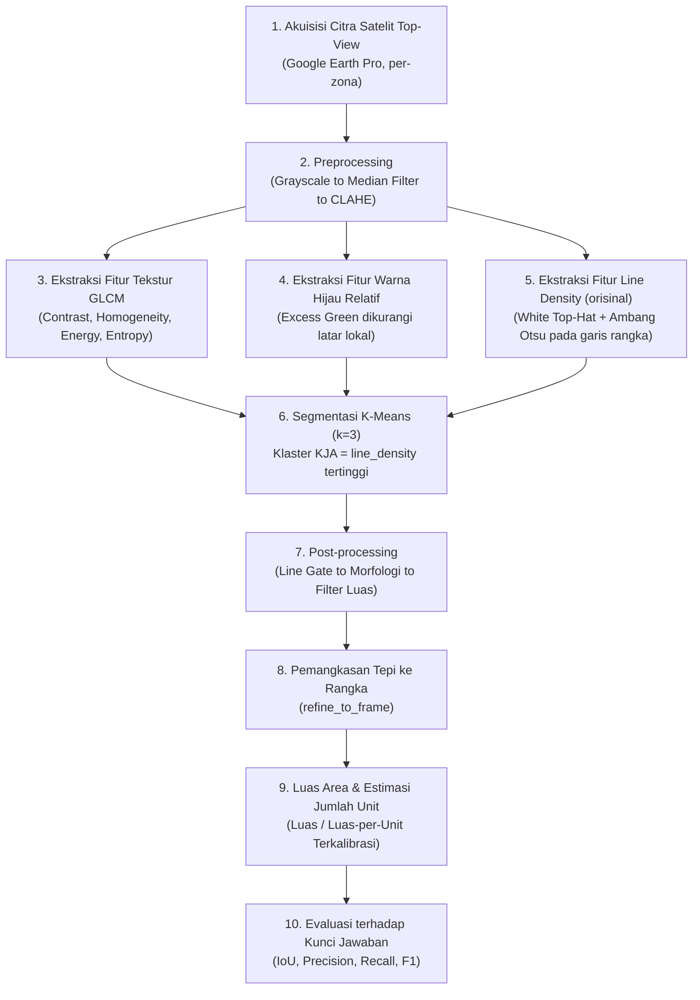

# 🛰️ Deteksi dan Estimasi Jumlah Unit Keramba Jaring Apung (KJA) di Waduk Jatiluhur Berbasis Citra Satelit & Pengolahan Citra Digital Klasik

[](https://www.python.org/)
[](https://opencv.org/)
[](https://scikit-learn.org/)
[](https://colab.research.google.com/)
[](https://www.google.com/earth/versions/)

---

## 👥 Tim Peneliti

Proyek Tugas Besar Mata Kuliah **Pengolahan Citra Digital (PCD)**
**Program Studi Informatika — Semester 5**

| No | Nama Mahasiswa | NIM | Peran Utama |
|:--:|:---|:---:|:---|
| 1 | **Akhsya** |241524039| Pengembangan pipeline PCD, fitur `line_density`, evaluasi & kalibrasi, notebook Colab |
| 2 | **Dayan** |241524037| Pengumpulan citra & ground truth (area padat, Zona 1–2), hitung manual baris keramba |
| 3 | **Aufa** |241524052| Pengumpulan citra & ground truth (area tanaman padat, Zona 3–5), hitung manual baris keramba |

---

## 📌 1. Latar Belakang & Urgensi Masalah

Waduk Jatiluhur menampung ribuan unit **Keramba Jaring Apung (KJA)** yang digunakan untuk budidaya ikan. Jumlah unit KJA yang melebihi daya dukung perairan berdampak pada penurunan kualitas air (eutrofikasi) dan keberlanjutan ekosistem waduk. Pendataan jumlah unit KJA secara manual di lapangan memakan waktu dan biaya besar untuk area waduk seluas ini, sehingga dibutuhkan pendekatan berbasis **citra satelit** yang bisa diperbarui secara berkala.

Proyek ini membangun pipeline **Pengolahan Citra Digital klasik (non deep learning)** — karena tidak tersedia dataset citra KJA berlabel dalam jumlah besar untuk pelatihan model — untuk mendeteksi area KJA dari citra satelit top-view (Google Earth Pro) dan mengestimasi jumlah unitnya, lalu memvalidasi hasilnya terhadap kunci jawaban yang ditandai manual.

---

## 🔬 2. Alur Pipeline Pengolahan Citra Digital



### Mengapa ada fitur `line_density`?

Ini adalah kontribusi utama kami. KJA, tanaman mengapung, dan hutan/daratan bisa punya tekstur GLCM yang mirip (sama-sama "ramai" secara visual), sehingga segmentasi berbasis warna atau tekstur GLCM saja gampang salah tandai. Rangka KJA selalu berupa **garis tipis dan terang**, sedangkan tanaman mengapung dan hutan tidak. Fitur ini mengukur kerapatan garis tipis tersebut lewat operasi morfologi *white top-hat*, sehingga memisahkan KJA dari tanaman/hutan sekaligus mencegah batas area KJA melebar ke air di sekitarnya.

### Landasan Matematis

1. **GLCM (Gray-Level Co-occurrence Matrix)** — dihitung per jendela geser, menangkap hubungan antar-piksel bertetangga:
   - *Contrast*: $\sum_{i,j} (i-j)^2 \, P(i,j)$
   - *Homogeneity*: $\sum_{i,j} \frac{P(i,j)}{1+(i-j)^2}$
   - *Energy*: $\sum_{i,j} P(i,j)^2$
   - *Entropy*: $-\sum_{i,j} P(i,j)\log_2 P(i,j)$

2. **Line Density (White Top-Hat):**
   $$\text{TopHat}(I) = I - (I \circ B)$$
   dengan $I \circ B$ adalah *opening* morfologi citra $I$ dengan elemen struktur $B$. Piksel hasil top-hat di atas ambang Otsu dan tidak hijau dianggap bagian garis rangka, lalu dirata-ratakan dalam jendela untuk mendapat peta kerapatan.

3. **Intersection over Union (IoU)** — metrik evaluasi utama terhadap kunci jawaban:
   $$\text{IoU} = \frac{|\text{Prediksi} \cap \text{Kunci Jawaban}|}{|\text{Prediksi} \cup \text{Kunci Jawaban}|}$$

4. **Kalibrasi Luas per Unit** — luas rata-rata satu unit (kotak) KJA, diukur langsung dari data riil, bukan diasumsikan dari literatur:
   $$\overline{A}_{\text{unit}} = \frac{1}{n}\sum_{i=1}^{n} \frac{A_{\text{baris}_i}}{N_{\text{kotak}_i}}$$

---

## 📊 3. Temuan Kuantitatif Utama

### Evaluasi akurasi terhadap kunci jawaban manual

| Skenario Citra | IoU (Warna Saja) | IoU (Tekstur + Garis) | Akurasi Piksel |
|:---|:---:|:---:|:---:|
| **Area Terbuka** (padat, mudah) | 0.25 | **0.84** | 97.3% |
| **Area Tanaman Mengapung Padat** (sulit) | 0.12 | **0.73** | 94.2% |

> ⚠️ **Insight Kunci:** Di skenario tersulit, segmentasi berbasis warna saja hampir gagal total (IoU 0.12). Pendekatan tekstur + kerapatan garis rangka terbukti jauh lebih andal, terutama saat KJA bercampur dengan tanaman mengapung.

### Kalibrasi luas per unit KJA

| Sumber | Luas per Unit | Catatan |
|:---|:---:|:---|
| Hasil kalibrasi kami | **64.1 ± 5.8 m²** | Diukur langsung dari 10 baris keramba (data Dayan + Aufa) |
| Standar literatur | 49.0 m² | Asumsi 7×7 m *(isi sitasi lengkap dari studi literatur kalian)* |

Selisih **+30.8%** dicatat sebagai temuan (bukan kesalahan) — kemungkinan ukuran kotak keramba di Jatiluhur memang lebih besar dari lokasi acuan di literatur.

### Estimasi total se-Waduk Jatiluhur (progress berjalan)

Area KJA di Jatiluhur terkonsentrasi di 5 zona yang dipotret dalam 12 screenshot Google Earth. Estimasi sementara: **±214 hektar, ±33.400 unit KJA** sebagai nilai tengah, dengan rentang kasar **195–231 ha (±30.500–36.000 unit)**. Notebook 07 menghitung skenario batas bawah (skala tiap screenshot apa adanya): 195 ha, 30.457 unit; koreksi untuk tile yang diambil dengan kamera miring menaikkannya, terutama di Zona 3+4.

| Zona | Luas (ha) | Estimasi unit | Catatan |
|:---|:---:|:---:|:---|
| Zona 1 | ±46–52 | ±7.100–8.000 | Screenshot di-zoom jauh (±1,5 m/px), deteksi kasar |
| Zona 2 | ±74–86 | ±11.500–13.400 | Screenshot di-zoom jauh (±1,5–1,8 m/px), deteksi kasar |
| Zona 3 + 4 | ±25–40 | ±3.800–6.300 | Zona 3 dan 4 ternyata memotret hamparan yang sama, digabung (5 tile) |
| Zona 5 | ±52 | ±8.200 | Tidak ada irisan antar-tile |

**Temuan penting selama pemrosesan zona (dicatat sebagai batasan metode):**
- **Screenshot saling tumpang tindih.** Irisan antar-tile ditemukan otomatis (pencocokan fitur SIFT + homografi) lalu dibuang supaya area yang sama tidak terhitung dua kali. Sebelum koreksi ini, total mentah kelebihan hitung.
- **Skala garis skala tidak selalu valid.** Beberapa screenshot diambil dengan kamera miring atau berputar, sehingga m/px tidak seragam di seluruh frame (di satu tile, bagian atas ±40% lebih jauh dari bagian bawah). Screenshot berikutnya sebaiknya diambil tegak lurus (Google Earth Pro: tekan **U** dan **N**).
- **Label teks Google Earth bisa mengacaukan K-Means.** Teks putih membentuk klaster dengan kerapatan garis ekstrem sehingga terpilih sebagai "KJA"; diatasi dengan menghapus label (inpaint) sebelum ekstraksi fitur.
- **Screenshot yang di-zoom jauh (di atas ±1,5 m/px)** membuat garis rangka tipis berukuran di bawah satu piksel, jadi deteksi lebih kasar.

---

## 📁 4. Struktur Repositori

Repositori disusun per tahap pipeline: setiap tahap punya satu notebook bernomor, dan keluarannya disimpan di subfolder `results/` dengan nama yang sama.

```text
Deteksi-KJA-Jatiluhur/
├── README.md
├── requirements.txt
├── src/
│   └── kja_pipeline.py                  # modul inti: semua fungsi pipeline PCD
├── dataset/
│   ├── raw/
│   │   ├── screenshots/                 # 12 screenshot mentah Google Earth (5 zona) + metadata.csv
│   │   └── potongan_evaluasi/           # 2 potongan citra bersih untuk pengembangan dan evaluasi
│   └── answer_key/                      # kunci jawaban (tanda manual) Dayan dan Aufa
├── notebooks/
│   ├── 01_image_quality_assessment.ipynb
│   ├── 02_scale_calibration_and_cleaning.ipynb
│   ├── 03_preprocessing_and_feature_extraction.ipynb
│   ├── 04_kmeans_segmentation.ipynb
│   ├── 05_postprocessing_and_area_estimation.ipynb
│   ├── 06_evaluation_and_unit_calibration.ipynb
│   ├── 07_zone_tile_merging_and_total_estimate.ipynb
│   └── kja_proof_of_concept_colab.ipynb # versi satu notebook, dijalankan dari atas ke bawah di Google Colab
└── results/
    ├── quality_assessment/              # gambar IQA per citra + quality_summary.csv
    ├── cleaning/                        # kalibrasi skala (scale_calibration.csv) + sebelum/sesudah pembersihan
    ├── features/                        # preprocessing, peta GLCM, warna hijau, line_density
    ├── segmentation/                    # peta klaster K-Means + ringkasan klaster
    ├── postprocessing/                  # mask akhir, overlay, perbandingan tahapan, area_summary.csv
    ├── evaluation/                      # peta kesalahan, evaluation_summary.csv, IoU vs pembanding
    └── zone_estimation/                 # overlay per tile, per_tile.csv, ringkasan_total_waduk.csv
```

| Notebook | Tahap | Keluaran utama |
|:---|:---|:---|
| `01_image_quality_assessment` | Menilai kualitas tiap citra: histogram RGB/HSV/gray, mean, std, entropi, ketajaman, persentase label dan daratan | `results/quality_assessment/` |
| `02_scale_calibration_and_cleaning` | Ukur garis skala (m/px), crop bawah, hapus label teks, topeng daratan | `results/cleaning/` |
| `03_preprocessing_and_feature_extraction` | Grayscale, median, CLAHE; fitur GLCM, hijau relatif, `line_density` | `results/features/` |
| `04_kmeans_segmentation` | K-Means k=3, pemilihan klaster KJA lewat `line_density` | `results/segmentation/` |
| `05_postprocessing_and_area_estimation` | Line gate, pangkas tepi ke rangka, morfologi, luas dan estimasi unit | `results/postprocessing/` |
| `06_evaluation_and_unit_calibration` | IoU, precision, recall, F1 terhadap kunci jawaban; kalibrasi luas per unit | `results/evaluation/` |
| `07_zone_tile_merging_and_total_estimate` | Pipeline pada 12 screenshot, buang irisan antar-tile, total se-Waduk | `results/zone_estimation/` |

---

## 🚀 5. Panduan Menjalankan Proyek

### Opsi A: Google Colab (satu notebook, tanpa instalasi)
1. Buka `notebooks/kja_proof_of_concept_colab.ipynb` di Google Colab.
2. Jalankan sel dari atas ke bawah (`Runtime → Run all`).
3. Di bagian **Upload**, pilih citra dan kunci jawabannya (ada di folder `dataset/`).
4. Hasil tersimpan ke folder `hasil/` dan bisa diunduh sebagai zip.
5. Untuk **screenshot mentah per zona**, pakai **Bagian 10** notebook yang sama (otomatis memotong tepi bawah, menghapus label teks, membuang daratan, dan menghapus area yang terhitung dobel).

### Opsi B: Lokal (notebook bernomor)
```bash
git clone https://github.com/<username>/Deteksi-KJA-Jatiluhur.git
cd Deteksi-KJA-Jatiluhur
pip install -r requirements.txt
jupyter notebook notebooks/
```
Jalankan berurutan **01 → 07**. Catatan urutan: `03` menyimpan fitur ke `results/features/cache/` yang dipakai `04` dan `05`; `02` menghasilkan `scale_calibration.csv` yang dipakai `07`. Notebook `03` dan `07` paling lama (GLCM dihitung per jendela geser; `07` memproses 12 screenshot, sekitar 10 sampai 15 menit).

> Seluruh keluaran di `results/` sudah disertakan dari hasil pemrosesan kami, jadi hasil bisa dilihat tanpa menjalankan ulang.

---

## 📝 6. Progress

### Sudah selesai
- [x] Studi literatur & penetapan topik final
- [x] Pipeline PCD lengkap: preprocessing → GLCM + warna hijau relatif + line density → K-Means → post-processing → refine tepi
- [x] Kunci jawaban manual (ground truth) untuk 2 skenario berbeda
- [x] Evaluasi kuantitatif (IoU, precision, recall, F1, akurasi piksel) terhadap kunci jawaban
- [x] Kalibrasi luas per unit KJA dari data riil (64.1 m²)
- [x] Notebook Colab reproducible, teruji jalan tanpa error dari awal sampai akhir

### Sedang berjalan
- [x] Pemrosesan screenshot 5 zona konsentrasi KJA (12 tile) dan estimasi total se-waduk sementara (±214 ha, ±33.400 unit)
- [x] Deteksi dan pembuangan irisan antar-screenshot (SIFT + homografi)
- [x] Repositori terstruktur: notebook bernomor 01 sampai 07 dengan keluaran per tahap di `results/`
- [ ] Verifikasi hitung manual baris Zona 3 dan 4 (hamparan yang sama, kemungkinan terhitung dobel)
- [ ] Ambil ulang screenshot Zona 1 dan 2 tegak lurus (tekan U dan N) dengan zoom ±0,7–1,0 m/px untuk memperkecil ketidakpastian skala

### Belum dimulai
- [ ] Penulisan laporan Bab I–V

---

## 📚 7. Referensi

*(lengkapi dengan daftar pustaka dari studi literatur kalian — termasuk sitasi lengkap untuk standar luas unit KJA 7×7 m yang dipakai sebagai pembanding kalibrasi)*
