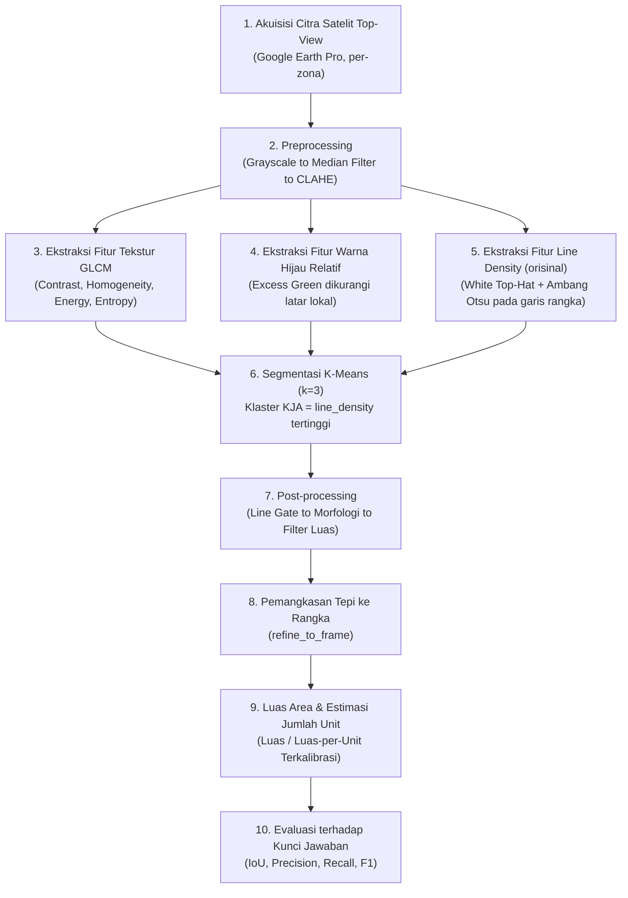

# 🛰️ Deteksi dan Estimasi Jumlah Unit Keramba Jaring Apung (KJA) di Waduk Jatiluhur Berbasis Citra Satelit & Pengolahan Citra Digital Klasik

[](https://www.python.org/)
[](https://opencv.org/)
[](https://scikit-learn.org/)
[](https://colab.research.google.com/)
[](https://www.google.com/earth/versions/)

---

## 👥 Tim Peneliti

Proyek Tugas Besar Mata Kuliah **Pengolahan Citra Digital (PCD)**
**Program Studi Informatika — Semester 5**

| No | Nama Mahasiswa | NIM | Peran Utama |
|:--:|:---|:---:|:---|
| 1 | **Akhsya** | `241524039` | Pengembangan pipeline PCD, fitur `line_density`, evaluasi & kalibrasi, notebook Colab |
| 2 | **Dayan** | `241524037` | Pengumpulan citra & ground truth (area padat, Zona 1–2), hitung manual baris keramba |
| 3 | **Aufa** | `241524052` | Pengumpulan citra & ground truth (area tanaman padat, Zona 3–5), hitung manual baris keramba |

---

## 📌 1. Latar Belakang & Urgensi Masalah

Waduk Jatiluhur menampung ribuan unit **Keramba Jaring Apung (KJA)** yang digunakan untuk budidaya ikan. Jumlah unit KJA yang melebihi daya dukung perairan berdampak pada penurunan kualitas air (eutrofikasi) dan keberlanjutan ekosistem waduk. Pendataan jumlah unit KJA secara manual di lapangan memakan waktu dan biaya besar untuk area waduk seluas ini, sehingga dibutuhkan pendekatan berbasis **citra satelit** yang bisa diperbarui secara berkala.

Proyek ini membangun pipeline **Pengolahan Citra Digital klasik (non deep learning)** — karena tidak tersedia dataset citra KJA berlabel dalam jumlah besar untuk pelatihan model — untuk mendeteksi area KJA dari citra satelit top-view (Google Earth Pro) dan mengestimasi jumlah unitnya, lalu memvalidasi hasilnya terhadap kunci jawaban yang ditandai manual.

---

## 🔬 2. Alur Pipeline Pengolahan Citra Digital



### Mengapa ada fitur `line_density`?

Ini adalah kontribusi utama kami. KJA, tanaman mengapung, dan hutan/daratan bisa punya tekstur GLCM yang mirip (sama-sama "ramai" secara visual), sehingga segmentasi berbasis warna atau tekstur GLCM saja gampang salah tandai. Rangka KJA selalu berupa **garis tipis dan terang**, sedangkan tanaman mengapung dan hutan tidak. Fitur ini mengukur kerapatan garis tipis tersebut lewat operasi morfologi *white top-hat*, sehingga memisahkan KJA dari tanaman/hutan sekaligus mencegah batas area KJA melebar ke air di sekitarnya.

### Landasan Matematis

1. **GLCM (Gray-Level Co-occurrence Matrix)** — dihitung per jendela geser, menangkap hubungan antar-piksel bertetangga:
   - *Contrast*: $\sum_{i,j} (i-j)^2 \, P(i,j)$
   - *Homogeneity*: $\sum_{i,j} \frac{P(i,j)}{1+(i-j)^2}$
   - *Energy*: $\sum_{i,j} P(i,j)^2$
   - *Entropy*: $-\sum_{i,j} P(i,j)\log_2 P(i,j)$

2. **Line Density (White Top-Hat):**
   $$\text{TopHat}(I) = I - (I \circ B)$$
   dengan $I \circ B$ adalah *opening* morfologi citra $I$ dengan elemen struktur $B$. Piksel hasil top-hat di atas ambang Otsu dan tidak hijau dianggap bagian garis rangka, lalu dirata-ratakan dalam jendela untuk mendapat peta kerapatan.

3. **Intersection over Union (IoU)** — metrik evaluasi utama terhadap kunci jawaban:
   $$\text{IoU} = \frac{|\text{Prediksi} \cap \text{Kunci Jawaban}|}{|\text{Prediksi} \cup \text{Kunci Jawaban}|}$$

4. **Kalibrasi Luas per Unit** — luas rata-rata satu unit (kotak) KJA, diukur langsung dari data riil, bukan diasumsikan dari literatur:
   $$\overline{A}_{\text{unit}} = \frac{1}{n}\sum_{i=1}^{n} \frac{A_{\text{baris}_i}}{N_{\text{kotak}_i}}$$

---

## 📊 3. Temuan Kuantitatif Utama

### Evaluasi akurasi terhadap kunci jawaban manual

| Skenario Citra | IoU (Warna Saja) | IoU (Tekstur + Garis) | Akurasi Piksel |
|:---|:---:|:---:|:---:|
| **Area Terbuka** (padat, mudah) | 0.25 | **0.84** | 97.3% |
| **Area Tanaman Mengapung Padat** (sulit) | 0.12 | **0.73** | 94.2% |

> ⚠️ **Insight Kunci:** Di skenario tersulit, segmentasi berbasis warna saja hampir gagal total (IoU 0.12). Pendekatan tekstur + kerapatan garis rangka terbukti jauh lebih andal, terutama saat KJA bercampur dengan tanaman mengapung.

### Kalibrasi luas per unit KJA

| Sumber | Luas per Unit | Catatan |
|:---|:---:|:---|
| Hasil kalibrasi kami | **64.1 ± 5.8 m²** | Diukur langsung dari 10 baris keramba (data Dayan + Aufa) |
| Standar literatur | 49.0 m² | Asumsi 7×7 m *(isi sitasi lengkap dari studi literatur kalian)* |

Selisih **+30.8%** dicatat sebagai temuan (bukan kesalahan) — kemungkinan ukuran kotak keramba di Jatiluhur memang lebih besar dari lokasi acuan di literatur.

### Estimasi total se-Waduk Jatiluhur (progress berjalan)

Area KJA di Jatiluhur terkonsentrasi di 5 zona. Status saat ini: **4 dari 5 zona berhasil diproses dengan baik**, total sementara **±213 hektar, ±33.280 unit KJA**. Satu zona (area tanaman padat) perlu diambil ulang dengan resolusi citra yang lebih rapat karena screenshot sebelumnya terlalu jauh zoom-nya untuk mendeteksi garis rangka secara andal.

---

## 📁 4. Struktur Berkas Repositori

```text
Deteksi-KJA-Jatiluhur/
├── README.md                   # Dokumentasi proyek (berkas ini)
├── kja_pipeline.py             # Modul inti: semua fungsi pipeline PCD
├── KJA_Jatiluhur.ipynb         # Notebook Google Colab (jalan dari atas ke bawah)
└── results/                    # (opsional) overlay hasil, peta kesalahan, ringkasan CSV
```

---

## 🚀 5. Panduan Menjalankan Proyek

Proyek ini dirancang untuk dijalankan di **Google Colab** (tidak perlu instalasi lokal):

1. Buka `KJA_Jatiluhur.ipynb` di Google Colab.
2. Jalankan sel dari atas ke bawah (`Runtime → Run all`).
3. Di bagian **Upload**, pilih citra potongan dan kunci jawabannya (kalau sudah ada).
4. Isi `CITRA`, `M_PER_PX`, dan `KUNCI_JAWABAN` di bagian Pengaturan sesuai citra yang diupload.
5. Hasil (mask, overlay, evaluasi, ringkasan) otomatis tersimpan ke folder `hasil/` dan bisa diunduh sebagai zip.

### Menjalankan secara lokal (opsional)

```bash
git clone https://github.com/<username>/Deteksi-KJA-Jatiluhur.git
cd Deteksi-KJA-Jatiluhur
pip install opencv-python numpy scikit-image scikit-learn pandas matplotlib
```

```python
import kja_pipeline as kp
# lihat KJA_Jatiluhur.ipynb untuk contoh alur pemakaian lengkap
```

---

## 📝 6. Progress

### Sudah selesai
- [x] Studi literatur & penetapan topik final
- [x] Pipeline PCD lengkap: preprocessing → GLCM + warna hijau relatif + line density → K-Means → post-processing → refine tepi
- [x] Kunci jawaban manual (ground truth) untuk 2 skenario berbeda
- [x] Evaluasi kuantitatif (IoU, precision, recall, F1, akurasi piksel) terhadap kunci jawaban
- [x] Kalibrasi luas per unit KJA dari data riil (64.1 m²)
- [x] Notebook Colab reproducible, teruji jalan tanpa error dari awal sampai akhir

### Sedang berjalan
- [ ] Pengumpulan & pemrosesan screenshot 5 zona konsentrasi KJA untuk estimasi total se-waduk (4/5 zona selesai)
- [ ] Re-capture citra Zona 4 dengan resolusi lebih rapat

### Belum dimulai
- [ ] Penulisan laporan

---

## 📚 7. Referensi

